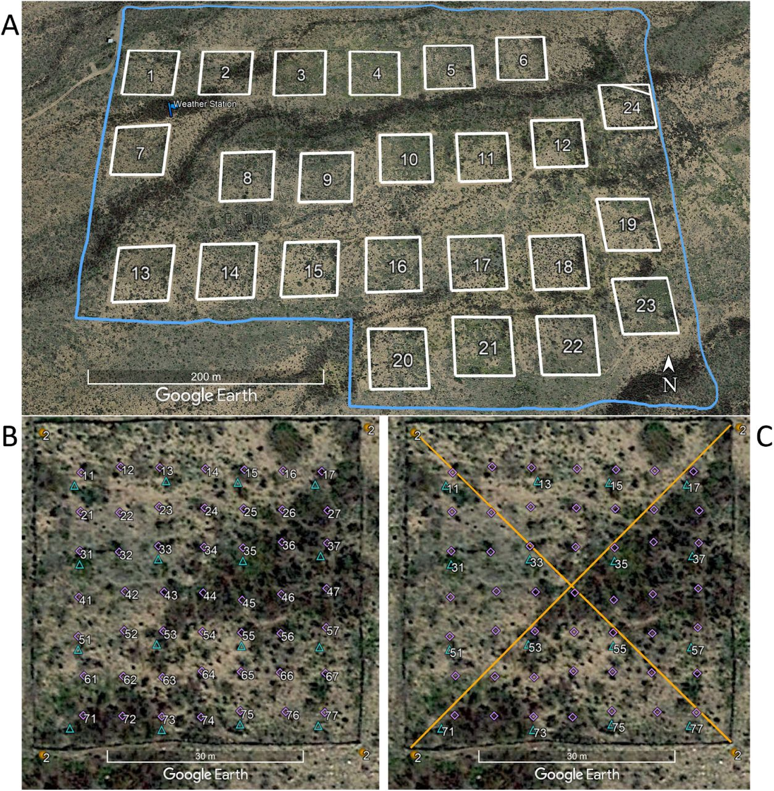
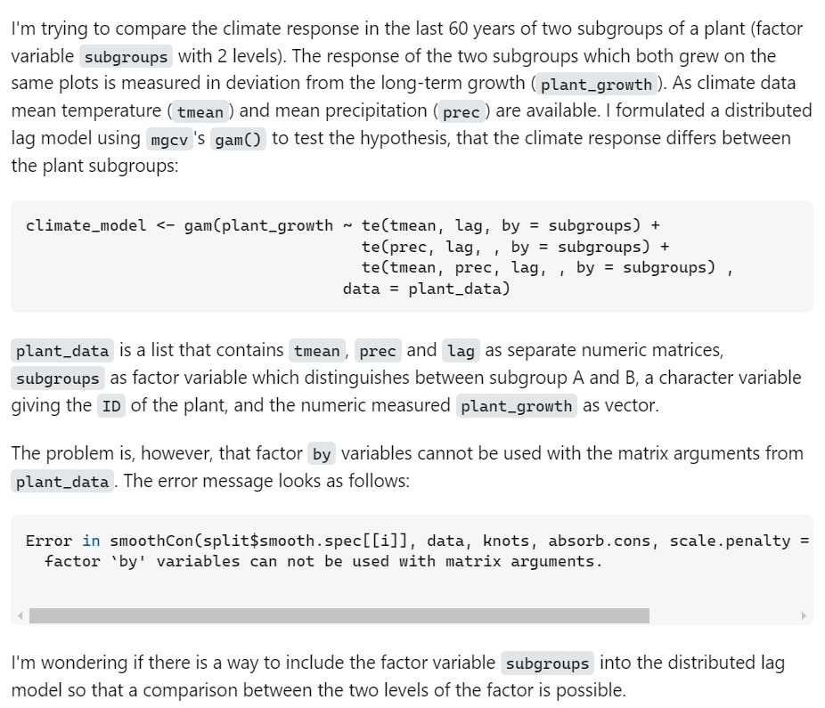

*Updated in November 2026: the code now needs `mvgam` 2.0 or higher. The [2.0 release post](https://ecogambler.netlify.app/blog/mvgam-2/) describes what changed.*

Here we will use `mgcv` to estimate parameters of nonlinear distributed lag models. These models are used to describe simultaneously non-linear and delayed functional relationships between a covariate and a response, and are sometimes referred to as exposure-lag-response models. If we assume `\(\tilde{\boldsymbol{y}}_{t}\)` is the conditional expectation of a response variable `\(\boldsymbol{y}\)` at time `\(\boldsymbol{t}\)`, and that `\(g\)` is a suitable inverse link function, the linear predictor for a distributed lag GAM with one lagged covariate is written as:
  
`$$g(\tilde{\boldsymbol{y}}_{t})={\boldsymbol{B}}_0+\sum\limits_{k=1}^K{f}(\boldsymbol{b}_{k,t}\boldsymbol{x}_{k,t})\,$$`
where `\(\boldsymbol{B}_{0}\)` is the unknown intercept and the `\(\boldsymbol{b}\)`'s are unknown spline coefficients estimating how the functional effect of covariate `\(\boldsymbol{x}\)` on `\(g(\tilde{\boldsymbol{y}}_{t})\)` changes over increasing lags (up to a maximum lag of `\(\boldsymbol{K}\)`). 

We will work with time series of rodent captures from the Portal Project, [a long-term monitoring study based near the town of Portal, Arizona](https://portal.weecology.org/). Researchers have been operating a standardized set of baited traps within 24 experimental plots at this site since the 1970's. Sampling follows the lunar monthly cycle, with observations occurring on average about 28 days apart. However, missing observations do occur due to difficulties accessing the site (weather events, COVID disruptions etc..). You can read about the full sampling protocol [in this preprint by Ernest et al on the Biorxiv](https://www.biorxiv.org/content/10.1101/332783v3.full). 



## Environment setup
This tutorial relies on the following packages:


``` r
library(mvgam)           # Fit, interrogate and forecast DGAMs
library(mgcv)            # Fit GAMs with list data
library(dplyr)           # Tidy and flexible data manipulation
library(ggplot2)         # Flexible plotting
library(gratia)          # Graceful plotting of smooth terms
library(viridis)         # Plotting colours
library(patchwork)       # Combining ggplot objects
```

A custom `ggplot2` theme; feel free to ignore if you have your own plot preferences

``` r
theme_set(theme_classic(base_size = 12, base_family = 'serif') +
            theme(axis.line.x.bottom = element_line(colour = "black",
                                                    linewidth = 1),
                  axis.line.y.left = element_line(colour = "black",
                                                  linewidth = 1)))
options(ggplot2.discrete.colour = c("#A25050",
                                    "#8F2727",
                                    'darkred',
                                    "#630000"),
        ggplot2.discrete.fill = c("#A25050",
                                  "#8F2727",
                                  'darkred',
                                  "#630000"))
```

## Load and inspect the Portal data
All data from the Portal Project are made openly available in near real-time so that they can provide the maximum benefit to scientific research and outreach ([a set of open-source software tools make data readily accessible](https://www.weecology.org/software-projects/portalr/)). These data are extremely rich, containing monthly counts of rodent captures for >20 species. But rather than accessing the raw data, we will use some data that I have already processed and put into a simple, usable form

``` r
portal_ts <- read.csv('https://raw.githubusercontent.com/nicholasjclark/EFI_seminar/main/data/portal_data.csv', as.is = T)
```

Inspect the data structure, which contains lunar monthly total captures across control plots for four different rodent species. It also contains a 12-month moving average of the unitless NDVI vegetation index, and monthly average minimum temperature (already scaled to unit variance)

``` r
dplyr::glimpse(portal_ts)
```

```
## Rows: 320
## Columns: 5
## $ captures  <int> 20, 2, 0, 0, NA, NA, NA, NA, 36, 5, 0, 0, 40, 3, 0, 1, 29, 3…
## $ time      <int> 1, 1, 1, 1, 2, 2, 2, 2, 3, 3, 3, 3, 4, 4, 4, 4, 5, 5, 5, 5, …
## $ species   <chr> "DM", "DO", "PB", "PP", "DM", "DO", "PB", "PP", "DM", "DO", …
## $ ndvi_ma12 <dbl> -0.172144125, -0.172144125, -0.172144125, -0.172144125, -0.2…
## $ mintemp   <dbl> -0.79633807, -0.79633807, -0.79633807, -0.79633807, -1.33471…
```
The data contain 80 lunar monthly observations, though there are plenty of NAs in the number of total captures (NAs are shown as red bars in the below plot)

``` r
max(portal_ts$time)
```

```
## [1] 80
```

``` r
image(is.na(t(portal_ts %>%
                dplyr::arrange(dplyr::desc(time)))), axes = F,
      col = c('grey80', 'darkred'))
axis(3, at = seq(0,1, len = NCOL(portal_ts)), 
     labels = colnames(portal_ts))
```

}}index_files/figure-html/unnamed-chunk-6-1.png" alt="Visualising features of time series data in R" width="60%" style="display: block; margin: auto;" />

The data are already in 'long' format, meaning each series x time observation has its own entry in the `data.frame`. But {`mvgam`} needs a `series` column that acts as a factor indicator for the time series. Add one using {`dplyr`} commands:

``` r
portal_ts %>%
  dplyr::mutate(series = as.factor(species)) -> portal_ts
dplyr::glimpse(portal_ts)
```

```
## Rows: 320
## Columns: 6
## $ captures  <int> 20, 2, 0, 0, NA, NA, NA, NA, 36, 5, 0, 0, 40, 3, 0, 1, 29, 3…
## $ time      <int> 1, 1, 1, 1, 2, 2, 2, 2, 3, 3, 3, 3, 4, 4, 4, 4, 5, 5, 5, 5, …
## $ species   <chr> "DM", "DO", "PB", "PP", "DM", "DO", "PB", "PP", "DM", "DO", …
## $ ndvi_ma12 <dbl> -0.172144125, -0.172144125, -0.172144125, -0.172144125, -0.2…
## $ mintemp   <dbl> -0.79633807, -0.79633807, -0.79633807, -0.79633807, -1.33471…
## $ series    <fct> DM, DO, PB, PP, DM, DO, PB, PP, DM, DO, PB, PP, DM, DO, PB, …
```

``` r
levels(portal_ts$series)
```

```
## [1] "DM" "DO" "PB" "PP"
```

It is important that the number of levels matches the number of unique series in the data to ensure indexing across series works properly in the underlying modelling functions. For more information on how to format data for {`mvgam`} modelling, see [the data formatting vignette in the package](https://nicholasjclark.github.io/mvgam/articles/data.html)

Now we can plot all of the time series together, using the `captures` measurement as our outcome variable

``` r
mvgam_data(portal_ts, y = 'captures', family = poisson())
```

```
## ✔ Data check passed for family 'poisson (link = log)'.
## • series: 4 levels
## • time:   1 to 80
## • n obs:  320 (68 NA)
```

}}index_files/figure-html/unnamed-chunk-8-1.png" alt="Visualising features of time series data in mvgam and R" width="60%" style="display: block; margin: auto;" />

We can also plot some more in-depth features for individual series

``` r
for(sp in levels(portal_ts$series)){
  print(mvgam_data(portal_ts, y = 'captures', family = poisson(),
                   series = sp))
}
```

```
## ✔ Data check passed for family 'poisson (link = log)'.
## • series: 4 levels
## • time:   1 to 80
## • n obs:  320 (68 NA)
```

}}index_files/figure-html/unnamed-chunk-9-1.png" alt="Visualising features of time series data in mvgam and R" width="60%" style="display: block; margin: auto;" />

```
## Validated data for family 'poisson (link = log)'.
##   series: 4 levels
##   time:   1 to 80
##   n obs:  320 (68 NA)
```

```
## ✔ Data check passed for family 'poisson (link = log)'.
## • series: 4 levels
## • time:   1 to 80
## • n obs:  320 (68 NA)
```

}}index_files/figure-html/unnamed-chunk-9-2.png" alt="Visualising features of time series data in mvgam and R" width="60%" style="display: block; margin: auto;" />

```
## Validated data for family 'poisson (link = log)'.
##   series: 4 levels
##   time:   1 to 80
##   n obs:  320 (68 NA)
```

```
## ✔ Data check passed for family 'poisson (link = log)'.
## • series: 4 levels
## • time:   1 to 80
## • n obs:  320 (68 NA)
```

}}index_files/figure-html/unnamed-chunk-9-3.png" alt="Visualising features of time series data in mvgam and R" width="60%" style="display: block; margin: auto;" />

```
## Validated data for family 'poisson (link = log)'.
##   series: 4 levels
##   time:   1 to 80
##   n obs:  320 (68 NA)
```

```
## ✔ Data check passed for family 'poisson (link = log)'.
## • series: 4 levels
## • time:   1 to 80
## • n obs:  320 (68 NA)
```

}}index_files/figure-html/unnamed-chunk-9-4.png" alt="Visualising features of time series data in mvgam and R" width="60%" style="display: block; margin: auto;" />

```
## Validated data for family 'poisson (link = log)'.
##   series: 4 levels
##   time:   1 to 80
##   n obs:  320 (68 NA)
```

Inspect some associations between `log(captures + 1)` and minimum temperature / NDVI moving average for each species to get a sense of how their relative abundances vary over seasons and with varying habitat conditions. First for **DM**

``` r
portal_ts %>% 
  dplyr::filter(species == 'DM', !is.na(captures)) %>%
  ggplot(aes(x = mintemp, y = log(captures + 1))) +
  geom_point() +
  geom_smooth(method = "gam", formula = y ~ s(x, k = 12),
              col = 'darkred', fill = "#A25050") +
  labs(title = 'DM',
       y = "log(captures)", 
       x = 'Minimum temperature') +
  
  portal_ts %>% 
  dplyr::filter(species == 'DM', !is.na(captures)) %>%
  ggplot(aes(x = ndvi_ma12, y = log(captures + 1))) +
  geom_point() +
  geom_smooth(method = "gam", formula = y ~ s(x, k = 12),
              col = 'darkred', fill = "#A25050") +
  labs(y = NULL, 
       x = 'NDVI moving average')
```

}}index_files/figure-html/unnamed-chunk-10-1.png" alt="Visualising features of time series data in ggplot2 and R" width="60%" style="display: block; margin: auto;" />

And for **PP**

``` r
portal_ts %>% 
  dplyr::filter(species == 'PP', !is.na(captures)) %>%
  ggplot(aes(x = mintemp, y = log(captures + 1))) +
  geom_point() +
  geom_smooth(method = "gam", formula = y ~ s(x, k = 12),
              col = 'darkred', fill = "#A25050") +
  labs(title = 'PP',
       y = "log(captures)", 
       x = 'Minimum temperature') +
  
  portal_ts %>% 
  dplyr::filter(species == 'PP', !is.na(captures)) %>%
  ggplot(aes(x = ndvi_ma12, y = log(captures + 1))) +
  geom_point() +
  geom_smooth(method = "gam", formula = y ~ s(x, k = 12),
              col = 'darkred', fill = "#A25050") +
  labs(y = NULL, 
       x = 'NDVI moving average')
```

}}index_files/figure-html/unnamed-chunk-11-1.png" alt="Visualising features of time series data in ggplot2 and R" width="60%" style="display: block; margin: auto;" />

Next for **PB**

``` r
portal_ts %>% 
  dplyr::filter(species == 'PB', !is.na(captures)) %>%
  ggplot(aes(x = mintemp, y = log(captures + 1))) +
  geom_point() +
  geom_smooth(method = "gam", formula = y ~ s(x, k = 12),
              col = 'darkred', fill = "#A25050") +
  labs(title = 'PB',
       y = "log(captures)", 
       x = 'Minimum temperature') +
  
  portal_ts %>% 
  dplyr::filter(species == 'PB', !is.na(captures)) %>%
  ggplot(aes(x = ndvi_ma12, y = log(captures + 1))) +
  geom_point() +
  geom_smooth(method = "gam", formula = y ~ s(x, k = 12),
              col = 'darkred', fill = "#A25050") +
  labs(y = NULL, 
       x = 'NDVI moving average')
```

}}index_files/figure-html/unnamed-chunk-12-1.png" alt="Visualising features of time series data in ggplot2 and R" width="60%" style="display: block; margin: auto;" />

And finally for **DO**

``` r
portal_ts %>% 
  dplyr::filter(species == 'DO', !is.na(captures)) %>%
  ggplot(aes(x = mintemp, y = log(captures + 1))) +
  geom_point() +
  geom_smooth(method = "gam", formula = y ~ s(x, k = 12),
              col = 'darkred', fill = "#A25050") +
  labs(title = 'DO',
       y = "log(captures)", 
       x = 'Minimum temperature') +
  
  portal_ts %>% 
  dplyr::filter(species == 'DO', !is.na(captures)) %>%
  ggplot(aes(x = ndvi_ma12, y = log(captures + 1))) +
  geom_point() +
  geom_smooth(method = "gam", formula = y ~ s(x, k = 12),
              col = 'darkred', fill = "#A25050") +
  labs(y = NULL, 
       x = 'NDVI moving average')
```

}}index_files/figure-html/unnamed-chunk-13-1.png" alt="Visualising features of time series data in ggplot2 and R" width="60%" style="display: block; margin: auto;" />
  
There may be some support for some nonlinear effects here, but we know that the rodents in this system do not show immediate responses to climatic or environmental changes. Rather, these responses are often *delayed*, and can be thought of as *cumulative* responses to varying conditions over a period of months. How can we capture these effects using GAMs? This is where distributed lag models come in.

## Setting up lag matrices
A lesser-known feature of `mgcv` is its ability to handle data in `list` format as opposed to the traditional `data.frame` format that most regression packages in R use. This allows us to supply some (or all) of our covariates as `matrices` rather than `vectors`, and opens many possibilities for more complex modeling. You can read a bit more about this using `?gam.models` and looking at the section on **Linear functional terms**. We can make use of this to set up the objects needed for estimating nonlinear distributed lag functions. 
  
Below is an exact reproduction of Simon Wood's lag matrix function (which he uses in his distributed lag example from his book [Generalized Additive Models - An Introduction with R 2nd edition](https://www.taylorfrancis.com/books/mono/10.1201/9781315370279/generalized-additive-models-simon-wood)). To use this function we need to supply a vector and specify the maximum lag that we want, and it will return a matrix of dimension `length(x) * lag`. Note that `NAs` are used for the missing lag values at the beginning of the matrix. In essence, the matrix objects represent exposure histories, where each row represents the lagged values of the predictor that correspond to each observation in our outcome variable. By creating a *tensor product* of this lagged covariate matrix and a matrix of equal dimensions that indicates which lag each cell in the covariate matrix represents, we can effectively set up a function that changes nonlinearly over lagged values of the covariate.

``` r
lagard <- function(x, n_lag = 6) {
  n <- length(x)
  X <- matrix(NA, n, n_lag)
  for (i in 1:n_lag){
    X[i:n, i] <- x[i:n - i + 1]
  } 
  X
}
```

We can make use of this function to organise all data needed for modeling into a list. For this simple example we will use lags of up to six months in the past. Some bookkeeping is necessary, as we must ensure that we remove the first five observations *for each series*. This is best achieved by arranging the data by `series` and then by `time`. I do this first to create the `mintemp` matrix

``` r
mintemp <- do.call(rbind, lapply(seq_along(levels(portal_ts$series)), function(x){
  portal_ts %>%
    dplyr::filter(series == levels(portal_ts$series)[x]) %>%
    dplyr::arrange(time) %>%
    dplyr::select(mintemp, time) %>%
    dplyr::pull(mintemp) -> tempdat
  
  lag_mat <- lagard(tempdat, 6)
  tail(lag_mat, NROW(lag_mat) - 5)
}))
dim(mintemp)[1]
```

```
## [1] 300
```

The lagged `mintemp` matrix now looks like this:

``` r
head(mintemp, 10)
```

```
##              [,1]        [,2]        [,3]        [,4]        [,5]        [,6]
##  [6,]  0.06532892 -0.42447625 -1.08048145 -1.24166462 -1.33471597 -0.79633807
##  [7,]  0.82279570  0.06532892 -0.42447625 -1.08048145 -1.24166462 -1.33471597
##  [8,]  1.16043027  0.82279570  0.06532892 -0.42447625 -1.08048145 -1.24166462
##  [9,]  1.35620578  1.16043027  0.82279570  0.06532892 -0.42447625 -1.08048145
## [10,]  1.25417764  1.35620578  1.16043027  0.82279570  0.06532892 -0.42447625
## [11,]  1.15421766  1.25417764  1.35620578  1.16043027  0.82279570  0.06532892
## [12,] -0.17521991  1.15421766  1.25417764  1.35620578  1.16043027  0.82279570
## [13,] -0.65285556 -0.17521991  1.15421766  1.25417764  1.35620578  1.16043027
## [14,] -1.47224270 -0.65285556 -0.17521991  1.15421766  1.25417764  1.35620578
## [15,] -1.26667509 -1.47224270 -0.65285556 -0.17521991  1.15421766  1.25417764
```

Now we can arrange the data in the same way and pull necessary objects into the `list`:

``` r
portal_ts %>%
  dplyr::arrange(series, time) %>%
  dplyr::filter(time > 5) -> portal_ts

data_all <- list(
  lag = matrix(0:5, nrow(portal_ts), 6, byrow = TRUE),
  captures = portal_ts$captures,
  ndvi_ma12 = portal_ts$ndvi_ma12,
  time = portal_ts$time,
  series = portal_ts$series)
```

And add the `mintemp` history matrix:

``` r
data_all$mintemp <- mintemp
```

The lag exposure history matrix looks as follows:

``` r
head(data_all$lag, 5)
```

```
##      [,1] [,2] [,3] [,4] [,5] [,6]
## [1,]    0    1    2    3    4    5
## [2,]    0    1    2    3    4    5
## [3,]    0    1    2    3    4    5
## [4,]    0    1    2    3    4    5
## [5,]    0    1    2    3    4    5
```

All other elements of the data list are in the usual vector format

``` r
head(data_all$captures, 5)
```

```
## [1] 25 29 23 22 NA
```

``` r
head(data_all$series, 5)
```

```
## [1] DM DM DM DM DM
## Levels: DM DO PB PP
```

``` r
head(data_all$time, 5)
```

```
## [1]  6  7  8  9 10
```


The dimensions of all the objects need to match up

``` r
dim(data_all$lag)
```

```
## [1] 300   6
```

``` r
dim(data_all$mintemp)
```

```
## [1] 300   6
```

``` r
length(data_all$time)
```

```
## [1] 300
```

## Fitting a distributed lag model for one species
The setup we have now is fine for fitting a distributed lag model to captures of just a single species. To illustrate how this works and what these models estimate, we can subset the data to only include observations for **PP**:

``` r
pp_inds <- which(data_all$series == 'PP')
data_pp <- lapply(data_all, function(x){
  if(is.matrix(x)){
    x[pp_inds, ]
  } else {
    x[pp_inds]
  }
})
```

Setting up the model is now very straightforward. We simply wrap the `lag` and `mintemp` matrices in a call to `te()`, which will set up a tensor product smoother (see `?mgcv::te` for details). I also use a smooth term for `ndvi_ma12` in this model, and stick with a Poisson observation model to keep things simple

``` r
mod1 <- gam(captures ~ 
              te(mintemp, lag, k = c(6, 4)) +
              s(ndvi_ma12),
            family = poisson(),
            data = data_pp,
            method = 'REML')
summary(mod1)
```

```
## 
## Family: poisson 
## Link function: log 
## 
## Formula:
## captures ~ te(mintemp, lag, k = c(6, 4)) + s(ndvi_ma12)
## 
## Parametric coefficients:
##             Estimate Std. Error z value Pr(>|z|)    
## (Intercept)   1.3736     0.0774   17.75   <2e-16 ***
## ---
## Signif. codes:  0 '***' 0.001 '**' 0.01 '*' 0.05 '.' 0.1 ' ' 1
## 
## Approximate significance of smooth terms:
##                    edf Ref.df Chi.sq p-value    
## te(mintemp,lag) 17.087 18.575 129.29  <2e-16 ***
## s(ndvi_ma12)     3.907  4.788  12.01  0.0296 *  
## ---
## Signif. codes:  0 '***' 0.001 '**' 0.01 '*' 0.05 '.' 0.1 ' ' 1
## 
## R-sq.(adj) =  0.616   Deviance explained = 67.2%
## -REML = 179.68  Scale est. = 1         n = 59
```

There will surely be autocorrelation left in the residuals from this model, but we will ignore that for now and focus on how to interpret the distributed lag term. Plotting these terms is easy with `mgcv`:

``` r
plot(mod1, select = 1, scheme = 2)
```

}}index_files/figure-html/unnamed-chunk-24-1.png" alt="Visualising distributed lag smooths in mgcv and R" width="60%" style="display: block; margin: auto;" />

Here the brighter yellow colours indicate larger linear predictor values, while the darker red colours indicate smaller linear predictor values. We can get a nicer plot of this effect using [Gavin Simpson's {`gratia`} package](https://gavinsimpson.github.io/gratia/). Note, I am currently using the development version of this package that was recently installed from Github. This is necessary for accurate plots of nonlinear functionals that include `by` terms (use `devtools::install_github('gavinsimpson/gratia')` to get the latest version) 

``` r
draw(mod1, select = 1)
```

}}index_files/figure-html/unnamed-chunk-25-1.png" alt="Visualising distributed lag smooths in mgcv and Gavin Simpson's gratia package in R" width="60%" style="display: block; margin: auto;" />

To me these bivariate heatmaps are a bit difficult to interpret, but more on that later.
  
Clearly there is support for a nonlinear effect of `mintemp` that changes over different lags, which is sensible given what we know about population dynamics in this system. But how can we incorporate such effects for *all species* in the model at once? The `by` argument in `mgcv` parlance can frequently be used to set up smoothers that vary across levels of a factor, and there are many extremely useful strategies for setting up hierarchical GAMs ([see this paper by Pedersen et al for some more context and many useful examples](https://peerj.com/articles/6876/)). But this option doesn't work when we are dealing with covariates that are stored in `matrix` format. In fact, there was [a recent post on StackOverflow asking about this very issue](https://stackoverflow.com/questions/75376475/gam-distributed-lag-model-with-factor-smooth-interaction-by-variable):



## Group-level and hierarchical distributed lags
I banged my head against the desk for several hours trying to fit hierarchical distributed lag models in {`mgcv`} for [a recent paper using these very data](https://github.com/nicholasjclark/portal_VAR). So I know exactly how the author of this post feels. Fortunately, I discovered that they are possible. The key of course is to carefully read the {`mgcv`} documentation. If you look at the help for linear functionals (`?mgcv::linear.functional.terms` and `?mgcv::gam.models`), you will see that the `by` variable is used in these cases as a *weighting matrix*. The resulting smooth is therefore constructed as `rowSums(L * F)`, where `F` is the distributed lag smooth and `L` is the weighting matrix. After reading this (several times) I finally realised that I needed to supply group-level distributed lag terms *for each group* in the formula. In short, we can create weight matrices for each level of the grouping factor to set up group-level and hierarchical distributed lag terms by doing this:

``` r
weights_dm <- weights_do <- weights_pb <- weights_pp <- matrix(1, ncol = ncol(data_all$lag), nrow = nrow(data_all$lag))
```

What we now have is a weighting matrix for each level of the grouping factor. Currently the weights are all set to `1` for each row of the data:

``` r
head(weights_dm)
```

```
##      [,1] [,2] [,3] [,4] [,5] [,6]
## [1,]    1    1    1    1    1    1
## [2,]    1    1    1    1    1    1
## [3,]    1    1    1    1    1    1
## [4,]    1    1    1    1    1    1
## [5,]    1    1    1    1    1    1
## [6,]    1    1    1    1    1    1
```

But to set up the appropriate group-level tensor products, we need to change these appropriately. Essentially, for each level in the grouping factor, the rows in that level's corresponding weighting matrix need to have `1`s when the corresponding observation in the data matches that level, and `0`s otherwise:

``` r
weights_dm[!(data_all$series == 'DM'), ] <- 0
weights_do[!(data_all$series == 'DO'), ] <- 0
weights_pb[!(data_all$series == 'PB'), ] <- 0
weights_pp[!(data_all$series == 'PP'), ] <- 0
```

Adding these weighting matrices to the data list gives us all we need to set up group-level or hierarchical distributed lag terms

``` r
data_all$weights_dm <- weights_dm
data_all$weights_do <- weights_do
data_all$weights_pb <- weights_pb
data_all$weights_pp <- weights_pp
```

Let's try it out! We will fit a multispecies GAM that includes distributed lag terms of `mintemp` for each species. It will also smooths of `ndvi_ma12` for each species, random intercepts for each species and smooths of `time` for each species. Again this model is probably not completely appropriate because it doesn't take temporal autocorrelation into account very well (though the smooths of `time` will help), but it is useful to illustrate some of these principles

``` r
mod2 <- gam(captures ~ 
              # Hierarchical intercepts
              s(series, bs = 're') +
              
              # Smooths of time to try and capture autocorrelation
              s(time, by = series, k = 30) +
              
              # Smooths of ndvi_ma12
              s(ndvi_ma12, by = series, k = 5) +
              
              # Distributed lags of mintemp
              te(mintemp, lag, k = c(6, 4), by = weights_dm) +
              te(mintemp, lag, k = c(6, 4), by = weights_do) +
              te(mintemp, lag, k = c(6, 4), by = weights_pb) +
              te(mintemp, lag, k = c(6, 4), by = weights_pp),
            family = poisson(),
            data = data_all,
            control = list(nthreads = 6),
            method = 'REML')
summary(mod2)
```

```
## 
## Family: poisson 
## Link function: log 
## 
## Formula:
## captures ~ s(series, bs = "re") + s(time, by = series, k = 30) + 
##     s(ndvi_ma12, by = series, k = 5) + te(mintemp, lag, k = c(6, 
##     4), by = weights_dm) + te(mintemp, lag, k = c(6, 4), by = weights_do) + 
##     te(mintemp, lag, k = c(6, 4), by = weights_pb) + te(mintemp, 
##     lag, k = c(6, 4), by = weights_pp)
## 
## Parametric coefficients:
##             Estimate Std. Error z value Pr(>|z|)  
## (Intercept)   1.7148     0.9174   1.869   0.0616 .
## ---
## Signif. codes:  0 '***' 0.001 '**' 0.01 '*' 0.05 '.' 0.1 ' ' 1
## 
## Approximate significance of smooth terms:
##                                  edf Ref.df  Chi.sq p-value    
## s(series)                  7.673e-16  4.000   0.000 0.59893    
## s(time):seriesDM           4.057e+00  4.930  73.546 < 2e-16 ***
## s(time):seriesDO           3.419e+00  4.173  39.097 < 2e-16 ***
## s(time):seriesPB           6.869e+00  8.209  87.160 < 2e-16 ***
## s(time):seriesPP           1.445e+01 17.310 100.342 < 2e-16 ***
## s(ndvi_ma12):seriesDM      2.784e+00  3.251  15.112 0.00269 ** 
## s(ndvi_ma12):seriesDO      3.268e+00  3.689  10.113 0.03430 *  
## s(ndvi_ma12):seriesPB      2.324e+00  2.766   5.122 0.17842    
## s(ndvi_ma12):seriesPP      1.654e+00  1.929   2.139 0.26882    
## te(mintemp,lag):weights_dm 4.492e+00  5.474  14.627 0.01855 *  
## te(mintemp,lag):weights_do 3.135e+00  3.440  16.120 0.02393 *  
## te(mintemp,lag):weights_pb 5.415e+00  6.281  13.108 0.04274 *  
## te(mintemp,lag):weights_pp 3.001e+00  3.001  19.558 0.00021 ***
## ---
## Signif. codes:  0 '***' 0.001 '**' 0.01 '*' 0.05 '.' 0.1 ' ' 1
## 
## Rank: 228/229
## R-sq.(adj) =  0.885   Deviance explained = 89.5%
## -REML = 557.76  Scale est. = 1         n = 236
```

Again, useful plots of the these smooth terms can be made using {`gratia`}

``` r
draw(mod2, select = 2:5)
```

}}index_files/figure-html/unnamed-chunk-31-1.png" alt="Visualising nonlinear smooths in mgcv and Gavin Simpson's gratia package in R" width="60%" style="display: block; margin: auto;" />


``` r
draw(mod2, select = 6:9)
```

}}index_files/figure-html/unnamed-chunk-32-1.png" alt="Visualising nonlinear smooths in mgcv and Gavin Simpson's gratia package in R" width="60%" style="display: block; margin: auto;" />


``` r
draw(mod2, select = 10:13)
```

}}index_files/figure-html/unnamed-chunk-33-1.png" alt="Visualising distributed lag smooths in mgcv and Gavin Simpson's gratia package in R" width="60%" style="display: block; margin: auto;" />

## Visualising distributed lag terms
If you are like me then you'll find these bivariate heatmap plots of the distributed lag terms rather difficult to interpret. Again, the more intense yellow/white colours indicate higher predicted values, with the deeper red colours representing lower predicted values, but actually making sense of how the functional response is expected to change over different lags is not easy from these plots. However, we can use the `predict.gam()` function to generate much more interpretable plots. To do so, we can generate a series of conditional predictions to visualise how the estimated function of `mintemp` changes over different lags for each species. This is done by setting up prediction data that zeros out all covariates apart from the covariate of interest. Ordinarily I'd use the wonderful [{`marginaleffects`} package](https://marginaleffects.com/) to automate this process, but unfortunately it doesn't work with data that are in `list` format (yet). So here is a rather lengthy function that will do the work for us. It works by iterating over lags and keeping all `mintemp` values at zero apart from the particular lag being predicted so that we can visualise how the predicted function changes over lags of `mintemp`. Predictions are generated on the link scale in this case, though you could also use the response scale. Note that we need to first generate predictions with all covariates (including the `mintemp` covariate) zeroed out to find the 'baseline' prediction (which will centre around the species' expected average count, on the log scale) so that we can shift by this baseline for generating a zero-centred plot. That way our resulting plot will roughly follow the traditional `mgcv` partial effect plots

``` r
plot_dist_lags = function(model, data_all){
  
  all_species <- levels(data_all$series)
  
  # Loop across species to create the effect plot dataframe
  sp_plot_dat <- do.call(rbind, lapply(all_species, function(sp){
    
    # Zero out all predictors to start the newdata
    newdata <- lapply(data_all, function(x){
      if(is.matrix(x)){
        matrix(0, nrow = nrow(x), ncol = ncol(x))
      } else {
        rep(0, length(x))
      }
    })
    
    # Modify to only focus on the species of interest
    newdata$series <- rep(sp, nrow(data_all$lag))
    newdata$lag <- data_all$lag
    which_weightmat <- grep(paste0('weights_', 
                                   tolower(sp)), 
                            names(newdata))
    newdata[[which_weightmat]] <- matrix(1, nrow = nrow(newdata[[which_weightmat]]),
                                         ncol = ncol(newdata[[which_weightmat]]))
    
    # Calculate predictions for when mintemp is zero to find the baseline
    # value for centring the plot
    preds <- predict(model, newdata = newdata, type = 'link')

    offset <- mean(preds)
    plot_dat <- do.call(rbind, lapply(seq(1:6), function(lag){
      # Set up prediction matrix for mintemp; 
      # use a sequence of values across the full range of observed values
      newdata$mintemp <- matrix(0, ncol = ncol(newdata$lag),
                                nrow = nrow(newdata$lag))
      newdata$mintemp[,lag] <- seq(min(data_all$mintemp),
                                   max(data_all$mintemp),
                                   length.out = length(newdata$time))
      
      # Predict on the link scale and shift by the offset 
      # so that values are roughly centred at zero
      preds <- predict(model, newdata = newdata, type = 'link')
      preds <- preds - offset
      
      data.frame(lag = lag - 1,
                 preds = preds,
                 mintemp = seq(min(data_all$mintemp),
                                   max(data_all$mintemp),
                                   length.out = length(newdata$time)))
    }))
    plot_dat$species <- sp
    
    plot_dat
  }))

  # Build the facetted distributed lag plot
  ggplot(data = sp_plot_dat %>%
           dplyr::mutate(lag = as.factor(lag)),
         aes(x = mintemp, y = preds, 
             colour = lag, fill = lag)) +
    facet_wrap(~ species, scales = 'free') +
    geom_hline(yintercept = 0) +
    # Use geom_smooth, though beware these uncertainty
    # intervals aren't necessarily correct
    geom_smooth() +
    scale_fill_viridis(discrete = TRUE) +
    scale_colour_viridis(discrete = TRUE) +
    labs(x = 'Minimum temperature (z-scored)',
         y = 'Partial effect')
  
}
```

Plot the conditional `mintemp` effects for each species

``` r
plot_dist_lags(mod2, data_all)
```

```
## `geom_smooth()` using method = 'loess' and formula = 'y ~ x'
```

}}index_files/figure-html/unnamed-chunk-35-1.png" alt="Visualising nonlinear distributed lag smooths in mgcv and R" width="60%" style="display: block; margin: auto;" />

There we have it. Now it is clear that some species show fairly strong responses to cumulative change in minimum temperature, while others do not. But the fact that we aren't effectively capturing temporal autocorrelation could be influencing these estimates. What happens if we do model temporal dynamics appropriately?

## Using mvgam to capture dynamic processes
Just as a quick illustration, I will show how a similar model can be fitted in {`mvgam`}, replacing the smooth functions of `time` with latent dynamic processes that can capture the temporal autocorrelation in the observations. {`mvgam`} builds its observation model with {`brms`}, which accepts matrix covariates stored as columns of a `data.frame`. But {`brms`} does not use the `by` weighting matrices the way {`mgcv`} does. Instead, we give each species its own copy of the lag and temperature matrices, holding zeros in every row that belongs to another species. Each species' tensor product then varies only within that species' rows

``` r
model_data <- portal_ts[, c('captures', 'ndvi_ma12', 'time', 'series')]
model_data$lag <- data_all$lag
model_data$mintemp <- data_all$mintemp
for(sp in levels(model_data$series)){
  in_species <- model_data$series == sp
  model_data[[paste0('mintemp_', tolower(sp))]] <- model_data$mintemp * in_species
  model_data[[paste0('lag_', tolower(sp))]] <- model_data$lag * in_species
}
```

The model gives each species an AR(1) process. With `cor = TRUE`, it also estimates correlations among the innovations of these processes. A shock to one species' abundance can then coincide with shocks to the others

``` r
mod3 <- mvgam(captures ~
                # Hierarchical intercepts
                (1 | series) +

                # Smooths of ndvi_ma12
                s(ndvi_ma12, by = series, k = 5) +

                # Distributed lags of mintemp
                t2(mintemp_dm, lag_dm, k = c(6, 4)) +
                t2(mintemp_do, lag_do, k = c(6, 4)) +
                t2(mintemp_pb, lag_pb, k = c(6, 4)) +
                t2(mintemp_pp, lag_pp, k = c(6, 4)),

              # Latent AR(1) processes with correlated innovations
              trend_formula = ~ AR(cor = TRUE),

              # A weakly informative prior on the fixed effects
              prior = prior(normal(0, 1), class = b),
              family = poisson(),
              data = model_data,
              silent = 2,
              seed = 1)
```

```
## Warning: Rows containing NAs were excluded from the model.
```

```
## Warning: 68 of 4000 (2.0%) transitions ended with a divergence.
## See https://mc-stan.org/misc/warnings for details.
```

```
## Warning: 3932 of 4000 (98.0%) transitions hit the maximum treedepth limit of 10.
## See https://mc-stan.org/misc/warnings for details.
```

When you run this model, the sampler warns that almost every transition reached the maximum tree depth. It also reports divergences in about 2% of transitions. Both warnings come from the structure of the model. Every row of the data holds the same lag matrix, with lags 0 to 5. Summing a function of lag alone over that fixed matrix gives the same number in every row of a species. The lag-only part of each tensor product is a constant per species, duplicating the species intercepts. The duplication creates a ridge in the posterior that the sampler must travel along. {`mgcv`} detects such duplicated columns and drops them, while {`brms`} keeps them. The `normal(0, 1)` prior stops the duplicated coefficients from drifting far. The ridge slows sampling but leaves the distributed lag effects untouched: the plots below compare predictions at different temperatures, a comparison in which the duplicated constants cancel

``` r
summary(mod3)
```

```
##  Family: poisson 
##   Links: mu = log 
## Formula: captures ~ (1 | series) + s(ndvi_ma12, by = series, k = 5) +  
##              t2(mintemp_dm, lag_dm, k = c(6, 4)) + t2(mintemp_do, lag_do,  
##              k = c(6, 4)) + t2(mintemp_pb, lag_pb, k = c(6, 4)) + t2(mintemp_pp,  
##              lag_pp, k = c(6, 4)) 
##    Data: model_data (Number of observations: 300) 
##  Series: 4 
##  Trends: AR(1) 
##   Draws: 4 chains, each with iter = 2000; warmup = 1000; thin = 1; 
##          total post-warmup draws = 4000
## 
## == Observation Model ==
## Smoothing Spline Hyperparameters:
##                           Estimate Est.Error l-95% CI u-95% CI Rhat Bulk_ESS
## sds(sndvi_ma12seriesDM_1)     1.02      0.95     0.04     3.48 1.00     1351
## sds(sndvi_ma12seriesDO_1)     1.22      1.26     0.04     4.42 1.00     2699
## sds(sndvi_ma12seriesPB_1)     1.55      1.39     0.06     4.97 1.00     1972
## sds(sndvi_ma12seriesPP_1)     1.67      1.61     0.06     5.62 1.00     2007
## sds(t2mintemp_dmlag_dm_1)     0.33      0.33     0.01     1.20 1.00     1598
## sds(t2mintemp_dmlag_dm_2)     1.35      1.36     0.04     4.92 1.00     2354
## sds(t2mintemp_dmlag_dm_3)     0.35      0.35     0.01     1.27 1.00     1694
## sds(t2mintemp_dolag_do_1)     0.62      0.57     0.02     2.10 1.00     2034
## sds(t2mintemp_dolag_do_2)     2.93      2.31     0.18     8.49 1.00     1652
## sds(t2mintemp_dolag_do_3)     0.72      0.75     0.02     2.74 1.00     1501
## sds(t2mintemp_pblag_pb_1)     0.72      0.72     0.02     2.64 1.00     1508
## sds(t2mintemp_pblag_pb_2)     2.57      2.34     0.07     8.43 1.00     1911
## sds(t2mintemp_pblag_pb_3)     1.00      0.84     0.06     3.14 1.00     1548
## sds(t2mintemp_pplag_pp_1)     0.79      0.79     0.02     2.89 1.00     1326
## sds(t2mintemp_pplag_pp_2)     1.99      1.87     0.06     6.68 1.00     2925
## sds(t2mintemp_pplag_pp_3)     0.71      0.67     0.03     2.47 1.00     2611
##                           Tail_ESS
## sds(sndvi_ma12seriesDM_1)     1728
## sds(sndvi_ma12seriesDO_1)     2551
## sds(sndvi_ma12seriesPB_1)     1712
## sds(sndvi_ma12seriesPP_1)     1926
## sds(t2mintemp_dmlag_dm_1)     1585
## sds(t2mintemp_dmlag_dm_2)     1570
## sds(t2mintemp_dmlag_dm_3)     1512
## sds(t2mintemp_dolag_do_1)     1852
## sds(t2mintemp_dolag_do_2)     1781
## sds(t2mintemp_dolag_do_3)     1562
## sds(t2mintemp_pblag_pb_1)     1798
## sds(t2mintemp_pblag_pb_2)     1367
## sds(t2mintemp_pblag_pb_3)     1719
## sds(t2mintemp_pplag_pp_1)     1037
## sds(t2mintemp_pplag_pp_2)     1953
## sds(t2mintemp_pplag_pp_3)     2598
## 
## Multilevel Hyperparameters:
## ~series (Number of levels: 4)
##               Estimate Est.Error l-95% CI u-95% CI Rhat Bulk_ESS Tail_ESS
## sd(Intercept)     1.99      1.73     0.08     6.38 1.00     1858     1715
## 
## Regression Coefficients:
##                       Estimate Est.Error l-95% CI u-95% CI Rhat Bulk_ESS
## Intercept                 1.66      3.27    -4.67     8.39 1.00     2673
## sndvi_ma12:seriesDM_1     0.25      0.77    -1.39     1.65 1.00     2284
## sndvi_ma12:seriesDO_1     0.52      0.90    -1.28     2.31 1.00     3358
## sndvi_ma12:seriesPB_1     0.11      0.88    -1.61     1.88 1.00     3765
## sndvi_ma12:seriesPP_1     0.17      0.89    -1.61     1.91 1.00     3639
## t2mintemp_dmlag_dm_1     -0.15      0.26    -0.67     0.41 1.00     1714
## t2mintemp_dmlag_dm_2     -0.03      0.03    -0.09     0.03 1.00     1858
## t2mintemp_dmlag_dm_3     -0.02      0.02    -0.06     0.02 1.00     2449
## t2mintemp_dolag_do_1      0.02      0.30    -0.60     0.64 1.00     1816
## t2mintemp_dolag_do_2     -0.03      0.08    -0.18     0.13 1.01     1173
## t2mintemp_dolag_do_3     -0.01      0.05    -0.10     0.08 1.00     2090
## t2mintemp_pblag_pb_1      0.11      0.31    -0.53     0.75 1.00     1696
## t2mintemp_pblag_pb_2      0.04      0.08    -0.11     0.22 1.00     1455
## t2mintemp_pblag_pb_3      0.08      0.05    -0.01     0.18 1.00     2151
## t2mintemp_pplag_pp_1      0.02      0.29    -0.60     0.60 1.00     1635
## t2mintemp_pplag_pp_2     -0.07      0.06    -0.20     0.06 1.00     1617
## t2mintemp_pplag_pp_3      0.21      0.05     0.11     0.32 1.00     2179
##                       Tail_ESS
## Intercept                 1384
## sndvi_ma12:seriesDM_1     2808
## sndvi_ma12:seriesDO_1     3110
## sndvi_ma12:seriesPB_1     3017
## sndvi_ma12:seriesPP_1     2116
## t2mintemp_dmlag_dm_1      1744
## t2mintemp_dmlag_dm_2      2379
## t2mintemp_dmlag_dm_3      2483
## t2mintemp_dolag_do_1      1632
## t2mintemp_dolag_do_2      1552
## t2mintemp_dolag_do_3      2138
## t2mintemp_pblag_pb_1      1858
## t2mintemp_pblag_pb_2      1926
## t2mintemp_pblag_pb_3      2335
## t2mintemp_pplag_pp_1      1382
## t2mintemp_pplag_pp_2      1949
## t2mintemp_pplag_pp_3      2679
## 
## == Trend Model ==
## Trend Specific Parameters:
##                 Estimate Est.Error l-95% CI u-95% CI Rhat Bulk_ESS Tail_ESS
## sigma_trend[DM]     0.17      0.04     0.11     0.25 1.00     1834     2865
## sigma_trend[DO]     0.31      0.09     0.18     0.51 1.00     1599     2747
## sigma_trend[PB]     0.43      0.09     0.27     0.63 1.00     2151     2741
## sigma_trend[PP]     0.55      0.11     0.37     0.78 1.00     1787     2227
## ar1_trend[DM]       0.85      0.09     0.64     0.99 1.01      587      600
## ar1_trend[DO]       0.92      0.07     0.73     1.00 1.01     1218     1434
## ar1_trend[PB]       0.94      0.03     0.87     0.99 1.00     1579     1514
## ar1_trend[PP]       0.78      0.08     0.61     0.91 1.00     1483     1697
## 
## Draws were sampled using sampling(NUTS). For each parameter, Bulk_ESS
## and Tail_ESS are effective sample size measures, and Rhat is the potential
## scale reduction factor on split chains (at convergence, Rhat = 1).
## 
## Next steps:
##   - `pp_check(fit)`: posterior predictive checks
##   - `residual_cor(fit)`: implied correlations among series
##   - `forecast(fit, newdata = ...)`: out-of-sample forecasts
##   - `lfo_cv(fit)`: leave-future-out model comparison
##   - `conditional_effects(fit)`: covariate effects
## Use `how_to_cite(fit)` for a methods paragraph and `methods_md(fit)` for its equations.
```

The AR(1) coefficients are all well above zero, with posterior medians between 0.79 and 0.95. This persistence carries much of the variation in these counts, beyond what the covariates explain. Most correlations among the innovations are weak, but `PB` and `PP` share a clear positive correlation (posterior median 0.60):

``` r
plot(residual_cor(mod3))
```

}}index_files/figure-html/unnamed-chunk-39-1.png" alt="Correlations among latent process innovations from an mvgam model in R" width="60%" style="display: block; margin: auto;" />

The prediction function from above relies on the `list` data that {`mgcv`} uses. Here is a version for this model that works with the posterior draws directly. For each species, lag and temperature, it computes the difference between the linear predictor at that temperature and the linear predictor with temperature at zero. Because each draw gives its own difference, the plot can show 80% credible intervals in place of the smoothed curves used above

``` r
plot_dist_lags_mvgam = function(model, data){
  temps <- seq(min(data$mintemp), max(data$mintemp), length.out = 50)
  n_lag <- ncol(data$lag)
  zero <- matrix(0, length(temps) * n_lag, n_lag)

  sp_plot_dat <- do.call(rbind, lapply(levels(data$series), function(sp){
    # One row per temperature and lag; all other predictors are zero
    newdata <- data[rep(1, nrow(zero)), c('time', 'series', 'ndvi_ma12')]
    newdata$series <- factor(sp, levels = levels(data$series))
    newdata$ndvi_ma12 <- 0
    for(v in grep('^(mintemp|lag)_', names(data), value = TRUE)){
      newdata[[v]] <- zero
    }
    newdata[[paste0('lag_', tolower(sp))]] <- matrix(0:(n_lag - 1), nrow(zero),
                                                     n_lag, byrow = TRUE)

    # Predictions with temperature at zero give the baseline
    baseline <- posterior_linpred(model, newdata = newdata,
                                  process_error = FALSE)

    # Now place each temperature in one lag column at a time
    lag_id <- rep(seq_len(n_lag), each = length(temps))
    temp_mat <- zero
    temp_mat[cbind(seq_len(nrow(zero)), lag_id)] <- rep(temps, n_lag)
    newdata[[paste0('mintemp_', tolower(sp))]] <- temp_mat
    effect <- posterior_linpred(model, newdata = newdata,
                                process_error = FALSE) - baseline

    data.frame(species = sp,
               lag = factor(lag_id - 1),
               mintemp = rep(temps, n_lag),
               est = apply(effect, 2, median),
               lower = apply(effect, 2, quantile, probs = 0.1),
               upper = apply(effect, 2, quantile, probs = 0.9))
  }))

  ggplot(sp_plot_dat, aes(x = mintemp, y = est,
                          colour = lag, fill = lag)) +
    facet_wrap(~ species, scales = 'free_y') +
    geom_hline(yintercept = 0, linetype = 'dashed') +
    geom_ribbon(aes(ymin = lower, ymax = upper),
                alpha = 0.12, colour = NA) +
    geom_line(linewidth = 1) +
    scale_fill_viridis(discrete = TRUE) +
    scale_colour_viridis(discrete = TRUE) +
    labs(x = 'Minimum temperature (z-scored)',
         y = 'Partial effect')
}
```


``` r
plot_dist_lags_mvgam(mod3, model_data)
```

}}index_files/figure-html/unnamed-chunk-41-1.png" alt="Visualising nonlinear distributed lag effects from an mvgam model in R" width="60%" style="display: block; margin: auto;" />

The broad patterns match the {`mgcv`} estimates. `PP` shows the clearest response: warm months raise captures in the same month but lower them three to five months later. `PB` responds mainly to the current month's temperature. What changes is our certainty. Once the latent AR(1) processes absorb the temporal autocorrelation, the intervals are wide. For `DM` the 80% intervals include zero at every lag, while `DO` keeps only a weak negative response to warm months two and three months earlier. The latent processes themselves show how much variation the covariates leave unexplained:

``` r
plot(hindcast(mod3, type = 'trend'))
```

}}index_files/figure-html/unnamed-chunk-42-1.png" alt="Visualising latent dynamic time series processes in mvgam and R" width="60%" style="display: block; margin: auto;" />

We will leave it there for this post. Hopefully you find this useful at some point!

## Further reading
The following papers and resources offer useful material about Hierarchical Generalized Additive Models and distributed lag modeling
  
Clark, N. J., Ernest, S. K. M., Senyondo, H., Simonis, J. L., White, E. P., Yennis, G. M., & Karunarathna, K. A. N. K. (2023). [Multi-species dependencies improve forecasts of population dynamics in a long-term monitoring study](https://ecoevorxiv.org/repository/view/5143/). *Biorxiv*, doi: [https://doi.org/10.32942/X2TS34](https://doi.org/10.32942/X2TS34).
  
Gasparrini, A. (2014). [Modeling exposure–lag–response associations with distributed lag non‐linear models](https://onlinelibrary.wiley.com/doi/full/10.1002/sim.5963). *Statistics in Medicine*, 33(5), 881-899.
  
Karunarathna, K. A. N. K., Wells, K., & Clark, N. J. (2024). [Modelling nonlinear responses of a desert rodent species to environmental change with hierarchical dynamic generalized additive models](https://www.sciencedirect.com/science/article/pii/S0304380024000371). *Ecological Modelling*, 490, 110648.
  
Pedersen, E. J., Miller, D. L., Simpson, G. L., & Ross, N. (2019). [Hierarchical generalized additive models in ecology: an introduction with mgcv](https://peerj.com/articles/6876/). *PeerJ*, 7, e6876.  
